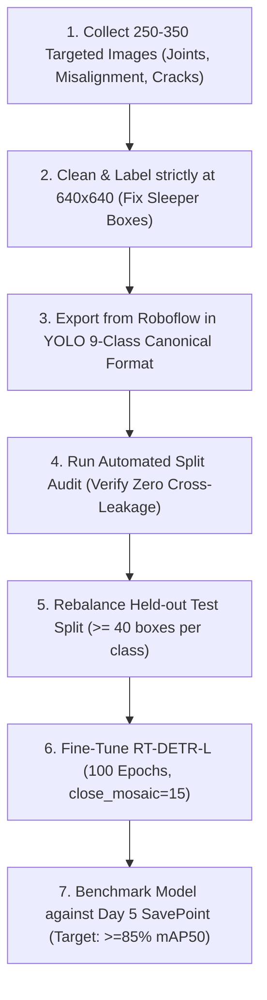

# RailSamiksha — Dataset Quality & Version 2.0 Expansion Guide
**Target**: Achieve **$\ge 85\%\text{--}90\%$ Defect Detection Accuracy ($\text{mAP}_{50}$)** using RT-DETR-L on NVIDIA RTX A4000  
**Current Dataset Baseline**: 2,544 Images | 4,293 Defect Boxes | **53.75% $\text{mAP}_{50}$**  
**Document Version**: 2.0 (Day 5 Post-Audit Specification)

---

## Executive Summary: Does Dataset v2.0 Need Additional Samples?

### **YES — But NOT generic images.**
Simply dumping 1,000 more generic sleeper photos will **not** increase accuracy, because Sleeper Defect already has 1,101 boxes. 

To break through from **53.75% to 85%+**, the next dataset version requires:
1. **~250 to 350 targeted images** specifically addressing the **3 starved classes** (Rail Joint Damage, Rail Misalignment, Hairline Rail Cracks).
2. **Re-annotation cleanup** for **Sleeper Defect** (fixing the 437 full-tie bounding box conflicts).
3. **Resolution harmonization** (standardizing all source images to native $640 \times 640$ without blur).

---

## 1. Class-by-Class Quota & Deficit Matrix for Dataset v2.0

| Class ID | Defect Class Name | Current Total Boxes | Current Test Score ($\text{mAP}_{50}$) | Additional Images Needed | Additional Boxes Needed | Priority | Focus Area |
| :---: | :--- | :---: | :---: | :---: | :---: | :---: | :--- |
| **5** | **Rail Joint Damage** | **223** | **18.1%** | **+80 to +100 imgs** | **+250 boxes** | 🔴 **CRITICAL** | Battered rail ends, cracked fishplates, sheared bolts, joint gaps |
| **6** | **Rail Misalignment** | **198** | **74.2%** *(fragile, 8 test boxes)* | **+40 to +60 imgs** | **+80 boxes** | 🔴 **HIGH** | Heat kinks, track snaking, lateral buckle, gauge widening |
| **4** | **Rail Crack** | **431** | **51.4%** | **+50 to +70 imgs** | **+150 boxes** | 🟠 **HIGH** | Hairline transverse fissures, wheel squats, head-checking |
| **1** | **Damaged Fastener** | **551** | **48.1%** | **+40 to +50 imgs** | **+300 boxes** | 🟠 **MEDIUM** | Bent Pandrol e-clips, cracked baseplates, dislodged pads |
| **3** | **Missing Fastener** | **545** | **47.9%** | **+30 to +40 imgs** | **+250 boxes** | 🟠 **MEDIUM** | Empty sleeper rail seats, dislodged clips |
| **7** | **Rail Wear** | **296** | **68.0%** | **+20 to +30 imgs** | **+80 boxes** | 🟡 **LOW** | Gauge-corner side wear on curves, metal flow |
| **0** | **Ballast Defect** | **333** | **68.2%** | **+20 to +30 imgs** | **+60 boxes** | 🟡 **LOW** | Shoulder washouts, churning mud pumps |
| **2** | **Foreign Objects** | **615** | **65.2%** | **+0 to +10 imgs** | **+20 boxes** | 🟢 **ENOUGH** | Maintenance tools, scrap metal, fallen rocks |
| **8** | **Sleeper Defect** | **1,101** | **42.6%** | **0 new imgs** | **0 new boxes** | 🔵 **RELABEL ONLY** | **Stop boxing entire ties!** Box only fractured concrete sections |
| **—** | **Clean Track Negatives** | **352** | — | **+50 clean imgs** | 0 boxes | ⚪ **ESSENTIAL** | Pristine track, turnouts, switches to suppress false alarms |
| **TOTAL** | **Target v2.0 Corpus** | **4,293** | **53.8%** | **+280 to +350 imgs** | **~1,200 boxes** | — | **Total Goal: ~2,850 images / ~5,500 boxes** |

---

## 2. Flight & Optical Capture Standards for New Samples

The primary reason small fastener defects and hairline cracks currently sit at ~48%–51% is **motion blur and inconsistent camera altitude**. All new drone captures must adhere to these physical flight parameters:

| Flight Parameter | Industrial Standard | Engineering Reason |
| :--- | :--- | :--- |
| **Gimbal Pitch Angle** | **Strictly 90° Nadir (Straight Down)** | Eliminates oblique perspective distortion of railhead |
| **Flight Altitude (AGL)** | **3.0 m to 4.5 m above railhead** | Ensures Pandrol clips span $\ge 55\text{px}$ across |
| **Ground Sample Distance (GSD)** | **0.5 mm to 0.8 mm / pixel** | Resolves hairline cracks down to 1.5 mm physical width |
| **Shutter Speed** | **$\ge 1/1000\text{ s}$ (Fixed manual shutter)** | Eliminates translational propeller vibration blur |
| **ISO Sensitivity** | **$\le 200\text{--}400$** | Prevents sensor grain noise from mimicking micro-cracks |
| **Flight Speed** | **5 km/h to 7 km/h** | Prevents rolling-shutter tearing on ties |
| **Drone Orientation** | **Parallel to Track Centerline** | Keeps rails aligned vertically in frame |

---

## 3. Strict Annotation Rules for Dataset v2.0 (Fixing Quality Flaws)

Our analytical audit uncovered severe labeling inconsistencies that penalize the neural network during training. Follow these rules when labeling the next version:

### Rule 1: Sleeper Defect (The 437-Box Bug Fix)
* **DO NOT** draw a single bounding box enclosing the entire 550px concrete sleeper tie.
* **DO** draw tight bounding boxes **only around the fractured, spalled, or broken concrete chunk**.
* If a sleeper has two separate cracks on opposite ends, draw **two separate small boxes**, not one giant rectangle across the track.

### Rule 2: Pandrol Fastener Assembly (Damaged vs. Missing)
* **DO NOT** enclose the entire iron baseplate or tie plate ($120 \times 120\text{px}$).
* **DO** draw tight bounding boxes around **the individual Pandrol e-clip / clip shoulder ($45 \times 45\text{px}$ to $60 \times 60\text{px}$)**.
* **Missing Fastener Rule**: Enclose the empty rail seat where the clip was supposed to be anchored. Keep identical proportions as a normal clip.

### Rule 3: Rail Joint Damage
* Box the **entire joint assembly**: the fishplate (joint bar), the gap between rail ends, and the bolts.
* If railhead ends are chipped or mushroomed, include the chipped railhead in the box.

### Rule 4: Rail Cracks
* Box the fissure with a margin of 5–10 pixels around the crack tips.
* If multiple micro-checks / squats exist within 30 pixels of each other, group them into a single coherent bounding box.

---

## 4. Step-by-Step Procedure to Build & Ingest Dataset v2.0

### Step-by-Step Execution:
1. **Curate the New Targeted Batch**:
   - Collect 80–100 Rail Joint photos, 50 Track Misalignment photos, 60 Hairline Crack photos, and 50 pristine track photos.
2. **Standardize Resolution to 640×640**:
   - Crop or slice 4K drone frames into native $640 \times 640$ patches without stretching.
3. **Audit Label Integrity**:
   - Run our audit script: `python scripts/analyze_dataset_deep.py` to confirm zero label anomalies and balanced distribution.
4. **Rebalance the Test Split**:
   - Ensure the held-out test split has **at least 35–50 defect boxes per class** so evaluation is statistically robust and not distorted by small sample counts.
5. **Launch Production Retraining**:
   - Train RT-DETR-L for **100 epochs** at native $640 \times 640$ with AdamW, cosine LR decay, and un-frozen backbone (`freeze=None`).

---

## 5. Summary Checklist Before Releasing Dataset v2.0

- [ ] Captured 80+ Rail Joint Damage instances (fishplates, battered ends).
- [ ] Captured 50+ Rail Misalignment instances (heat kinks, track snaking).
- [ ] Captured 60+ Rail Crack instances (sharp, unblurred hairline fissures).
- [ ] Cleaned Sleeper Defect: All 437 full-tie boxes replaced with localized crack boxes.
- [ ] Fasteners labeled tightly around the clip ($45\text{--}60\text{px}$), excluding baseplates.
- [ ] Added 50+ clean background track images (hard negatives).
- [ ] Uniform $640 \times 640$ image resolution across the entire dataset.
- [ ] Held-out test split guaranteed $\ge 35$ instances for all 9 defect classes.
